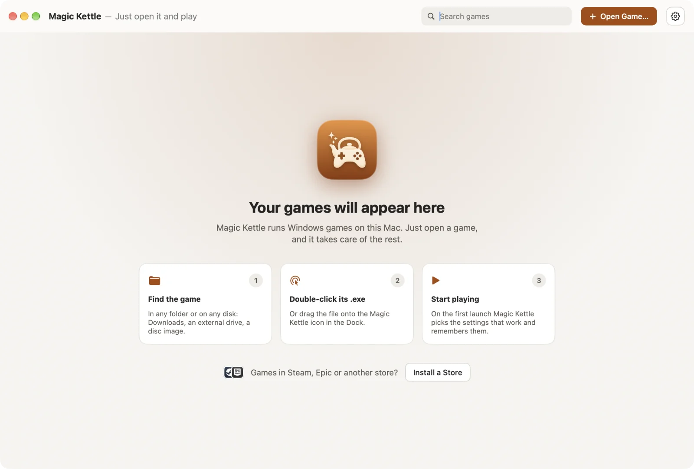

# Plaviox

**Windows games on your Apple Silicon Mac. Double-click the `.exe` and play.**

Plaviox runs Windows games on Apple Silicon Macs and does all the setup itself: it works out what the game needs,
finds the settings it runs best with and remembers them. No bottles, no prefixes, no Wine settings, no Windows to
install. Free and open source.

[**Download**](https://github.com/Zig1375/Plaviox/releases/latest) · [Website](https://zig1375.github.io/Plaviox/) ·
macOS 15 or later · Apple Silicon



## What it runs

- **DirectX 9, 10, 11 and 12.** Plaviox reads the game and picks how to draw it on Metal (DXMT, DXVK or WineD3D),
  trying the next one if the first fails. DirectX 12 games run on Apple's D3DMetal, which you
  [add from Apple yourself](https://zig1375.github.io/Plaviox/directx12.html) in a couple of minutes.
- **Steam and the Epic Games Store**, installed with one button. Their games install, sign in and start as on
  Windows.
- **Unity, RPG Maker XP/VX/VX Ace, NW.js and Electron games**, and games that need Visual C++ or .NET: Plaviox installs
  those from Microsoft only when a game needs them.
- **Installers and disc images**, BIN/CUE included, and old games that ask for their CD.
- **Old and small games made bigger**, smoothly, without switching your Mac's display; fixed-size windows can be
  stretched by their corner.
- **Japanese games** start with the right language and fonts.

All games share one profile, so saves stay put. Nothing about you or your games is sent anywhere, and every download
is checked against a pinned SHA-256.

## Install

1. Download `Plaviox-<version>.zip` from [Releases](https://github.com/Zig1375/Plaviox/releases/latest), open it and
   move **Plaviox** to **Applications**.
2. Open Plaviox. The first time, macOS says it can't verify the app and doesn't open it: Plaviox is free and isn't
   notarized by Apple, which needs a paid developer account. Click **Done**.
3. Open **System Settings › Privacy & Security**, scroll down to Security and click **Open Anyway** next to Plaviox,
   then confirm. macOS remembers this; from then on Plaviox opens like any other app.

Or, in Terminal, once:

```bash
xattr -dr com.apple.quarantine /Applications/Plaviox.app
```

On its first start Plaviox downloads what Windows games need (Wine, DXVK, DXMT), once, with a progress bar.

## Use

Double-click a game's `.exe` in Finder, drop its folder on Plaviox, or run its installer with Plaviox. The first launch
tries settings until the game runs well; after that the game simply starts from the library.

## How it works

Plaviox runs games on its own build of Wine 11.20, made and released by
[Plaviox-Runtime](https://github.com/Zig1375/Plaviox-Runtime): with osync, our in-process synchronization (9 to 26
times faster than wineserver on our benchmarks), and fixes for Rosetta 2, Steam, the Epic Games Launcher, game
controllers, stretched windows and D3DMetal. Settings for particular games come as data from
[Plaviox-Games](https://github.com/Zig1375/Plaviox-Games). The design is in [docs/ARCHITECTURE.md](docs/ARCHITECTURE.md)
(in Russian).

## Building

Needs macOS 15+, Apple Silicon and Xcode 16+.

```bash
swift test                 # PlavioxKit and CLI tests, no Wine needed
swift run plaviox help      # debugging CLI
brew install xcodegen
xcodegen generate          # creates Plaviox.xcodeproj from project.yml
open Plaviox.xcodeproj
```

## License

Apache-2.0. Wine, DXVK, DXMT and Wine Mono are downloaded separately under their own licenses. D3DMetal is Apple's
software: Plaviox never ships or downloads it.
